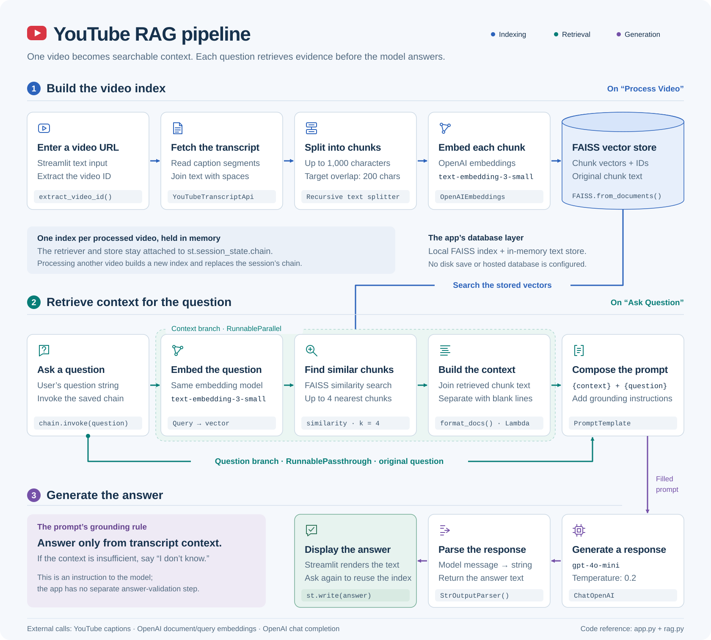

# YouTube RAG Chatbot

A Streamlit app that answers questions using a YouTube video's transcript. LangChain connects transcript retrieval, OpenAI embeddings, a local FAISS vector store, and an OpenAI chat model.

## Full RAG pipeline

[](docs/rag-pipeline.svg)

Open the diagram to zoom in. The SVG contains selectable text and vector shapes, so it stays sharp at any size and needs no external fonts, images, or JavaScript. A [PNG copy](docs/rag-pipeline.png) is also included for image previews or platforms that do not accept SVG.

### 1. Build the video index

Clicking **Process Video** runs this path:

1. `extract_video_id()` reads the video ID from the URL entered in Streamlit.
2. `get_transcript()` uses `YouTubeTranscriptApi().fetch(video_id)` to fetch captions, then joins the segment text with spaces. Segment timestamps are not retained.
3. `RecursiveCharacterTextSplitter` creates document chunks with a maximum size of **1,000 characters** and a target overlap of **200 characters**. These settings count characters, not tokens.
4. `OpenAIEmbeddings(model="text-embedding-3-small")` converts each chunk into a vector.
5. `FAISS.from_documents()` builds the vector index and retains the original chunk text. `build_chain()` creates the retriever and answer-generation chain, which is assigned to `st.session_state.chain`.

### 2. Retrieve context for each question

Clicking **Ask Question** calls `chain.invoke(question)`. `RunnableParallel` produces two inputs for the prompt:

| Branch | What happens |
| --- | --- |
| Context | The retriever embeds the question with the same embedding model, searches FAISS with `search_type="similarity"` and `k=4`, and returns up to four matching chunks. `RunnableLambda(format_docs)` joins their text with blank lines. |
| Question | `RunnablePassthrough()` preserves the original question string. |

`PromptTemplate` combines `{context}` and `{question}` with instructions to answer only from the transcript context and say it does not know when that context is insufficient.

### 3. Generate and display the answer

`ChatOpenAI(model="gpt-4o-mini", temperature=0.2)` generates a response. `StrOutputParser()` converts the returned model message into a string, and Streamlit displays it with `st.write(answer)`.

The grounding rule is a prompt instruction; there is no separate answer-validation component. Each new question repeats retrieval and generation while reusing the current video's index.

## The database layer

**FAISS is the app's local, in-memory vector store.** The LangChain wrapper keeps a vector index, a document store containing the chunk text, and a mapping from index positions to document IDs. The retriever retains this store through the chain in the current Streamlit session.

The app does not save the index to disk or use a hosted database. Processing another video creates a new index and replaces the session's chain. Transcript fetching, document/query embedding, and answer generation make external API calls; FAISS similarity search runs locally.

The current code does not implement conversation history, reranking, source citations, timestamp links, speech-to-text transcription, or web search.

## Embed the diagram elsewhere

For another Markdown document, adjust the relative path as needed:

```markdown

```

For your webpage, copy the SVG to your site's assets folder and use:

```html
<a href="/assets/rag-pipeline.svg">
  
</a>
```

The diagram includes its own light background for consistent contrast on both light and dark webpages. Its SVG `<title>` and `<desc>` describe the complete flow for accessible standalone viewing.
